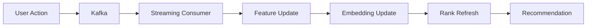

# 🎬 Netflix-Scale Recommendation Engine Platform

A production-grade, distributed recommendation engine capable of serving **100M+ users** with **sub-100ms latency**, inspired by platforms like Netflix, YouTube, Spotify, TikTok, Amazon, and Instagram.

## ✨ Features

### Core Capabilities
- ✅ **Personalized Recommendations**: Collaborative filtering + content-based filtering
- ✅ **Real-time Adaptation**: Kafka-powered streaming updates for immediate personalization
- ✅ **User & Item Embeddings**: Vector representations stored in Qdrant (512-dimension)
- ✅ **Deep Learning Ranking Models**: Two-Tower, DeepFM, Wide&Deep, SASRec/BERT4Rec
- ✅ **Feature Store**: Feast with online (Redis) and offline (Parquet/S3) storage
- ✅ **Session-Based Recommendations**: Dynamic adaptation based on current session
- ✅ **Explainable Recommendations**: Transparent reasoning for each recommendation

### Advanced Features
- ✅ **A/B Testing Framework**: Traffic splitting and performance tracking
- ✅ **Comprehensive Monitoring**: Prometheus + Grafana dashboards
- ✅ **Model Registry**: MLflow for experiment tracking and version control
- ✅ **Automated Retraining**: Airflow orchestrates training pipelines
- ✅ **Distributed Processing**: Apache Spark for batch feature engineering
- ✅ **CI/CD Pipeline**: GitHub Actions with blue-green deployments
- ✅ **Multi-cloud Support**: Terraform configs for AWS/GCP

## 🚀 Quick Start

### Prerequisites
- Docker >= 20.10
- Docker Compose >= 2.0
- Python >= 3.9
- Node.js >= 16 (for frontend development)

### Installation

```bash
# Clone repository
git clone <repository-url>
cd recommendation-engine

# Set up environment
cp .env.example .env
# Edit .env with your configuration

# Start all services
docker-compose up -d

# Run database migrations
docker-compose exec backend python -m app.core.database.migrate

# Seed sample data
docker-compose exec backend python -m ml.inference.seed_data
```

### Access Services

| Service | URL | Description |
|---------|-----|-------------|
| **Frontend Dashboard** | http://localhost:3000 | React/Next.js UI |
| **Backend API** | http://localhost:8000/docs | FastAPI documentation |
| **Qdrant Vector DB** | http://localhost:6333 | Embedded search |
| **MLflow Registry** | http://localhost:5000 | Model tracking |
| **Grafana Dashboard** | http://localhost:3001 | Monitoring visualization |
| **Prometheus** | http://localhost:9090 | Metrics collection |
| **Airflow UI** | http://localhost:8081 | Workflow orchestration |
| **Spark Master** | http://localhost:8082 | Batch processing |

## 📁 Project Structure

```
recommendation-engine/
├── README.md                      # This file
├── LICENSE                        # MIT License
├── .gitignore                     # Git ignore rules
├── docker-compose.yml             # Container orchestration
├── Makefile                       # Development commands
│
├── docs/                          # Documentation
│   ├── architecture.md           # System architecture
│   ├── system_design.md          # Detailed design
│   ├── api_documentation.md      # API reference
│   ├── ml_pipeline.md            # ML pipeline guide
│   └── deployment.md             # Deployment guide
│
├── frontend/                      # Next.js application
│   ├── src/
│   │   ├── pages/               # Pages (index.tsx, etc.)
│   │   ├── components/          # React components
│   │   ├── hooks/               # Custom hooks
│   │   ├── services/            # API clients
│   │   └── utils/               # Utilities
│   ├── public/                  # Static assets
│   ├── package.json             # Dependencies
│   ├── Dockerfile               # Frontend container
│   └── tailwind.config.js       # Styling config
│
├── backend/                       # FastAPI microservices
│   ├── app/
│   │   ├── main.py              # Application entry point
│   │   ├── core/                # Core configurations
│   │   │   ├── config.py        # Environment settings
│   │   │   └── database.py      # Database setup
│   │   ├── models/              # SQLAlchemy models
│   │   ├── api/                 # API routes
│   │   │   ├── routes/          # Route definitions
│   │   │   └── __init__.py     # Router composition
│   │   └── services/            # Business logic
│   │       ├── ml/              # ML inference service
│   │       └── feature_store/   # Feature store client
│   ├── Dockerfile               # Backend container
│   └── requirements.txt         # Python dependencies
│
├── ml/                            # Machine learning
│   ├── training/                  # Training pipelines
│   │   └── pipeline.py          # Main training code
│   ├── embeddings/                # Embedding generation
│   ├── ranking/                   # Ranking models
│   ├── inference/                 # Inference service
│   ├── evaluation/                # Evaluation metrics
│   └── models/                    # Model implementations
│       ├── two_tower.py         # Two-Tower network
│       ├── deepfm.py            # DeepFM model
│       └── sasrec.py            # Sequential recommender
│
├── feature_store/                 # Feast integration
│   ├── pipelines/                 # Feature pipelines
│   └── features/                  # Feature definitions
│
├── kafka/                         # Kafka event streaming
│   ├── producers/                 # Event producers
│   │   └── event_producer.py    # Producer implementation
│   └── consumers/                 # Event consumers
│
├── airflow/                       # Workflow orchestration
│   └── dags/                      # DAG definitions
│       └── training_dag.py      # Training pipeline DAG
│
├── spark/                         # Distributed computing
│   └── jobs/                      # Spark jobs
│       └── feature_engineering.py # Feature generation job
│
├── tests/                         # Test suite
│   ├── unit/                      # Unit tests
│   ├── integration/               # Integration tests
│   └── load/                      # Load/performance tests
│
├── monitoring/                    # Observability
│   ├── prometheus/                # Prometheus config
│   └── grafana/                   # Grafana dashboards
│       ├── dashboards/            # Dashboard definitions
│       └── datasources/           # Data source configs
│
├── kubernetes/                    # K8s manifests
│   ├── deployments/               # Deployment specs
│   ├── services/                  # Service definitions
│   └── ingress/                   # Ingress rules
│
└── terraform/                     # Infrastructure as Code
    ├── aws/                       # AWS infrastructure
    │   ├── main.tf               # Main configuration
    │   ├── variables.tf          # Variable definitions
    │   └── outputs.tf            # Output values
    └── gcp/                       # GCP infrastructure
```

## 🛠 Technology Stack

| Category | Technologies |
|----------|--------------|
| **Frontend** | Next.js, React, TypeScript, TailwindCSS |
| **Backend** | FastAPI, Python, SQLAlchemy |
| **Machine Learning** | PyTorch, TensorFlow, Scikit-learn, LightFM |
| **Vector Database** | Qdrant (ANN search with HNSW) |
| **Feature Store** | Feast (Online: Redis, Offline: Parquet) |
| **Streaming** | Apache Kafka |
| **Batch Processing** | Apache Spark |
| **Orchestration** | Apache Airflow |
| **Model Registry** | MLflow |
| **Monitoring** | Prometheus, Grafana |
| **Containerization** | Docker |
| **Orchestration** | Kubernetes |
| **Infrastructure** | Terraform (AWS/GCP) |

## 📊 Performance Targets

| Metric | Target |
|--------|--------|
| **Users Supported** | 100M+ |
| **Items Catalog** | 10M+ |
| **Throughput** | 100,000 requests/second |
| **Latency (p99)** | <100ms |
| **Availability** | 99.99% SLA |
| **Real-time Updates** | <1 second |

## 🔑 Key Components

### 1. Candidate Generation Layer
Multi-stage filtering to generate thousands of candidates:
- **Collaborative Filtering**: ALS matrix factorization
- **Content-Based Filtering**: Embedding similarity search
- **Retrieval Models**: Two-tower neural networks
- **Trending/Hybrid**: Recent popularity with time decay

### 2. Ranking Engine
Deep learning models for personalized scoring:
- **Two-Tower Network**: User and item embedding matching
- **DeepFM**: Feature interactions for CTR prediction
- **Wide & Deep**: Memorization + generalization
- **Transformer-based**: SASRec/BERT4Rec for sequential modeling

### 3. Feature Infrastructure
- **Feature Store (Feast)**: Real-time + batch features
- **Embedding Store (Qdrant)**: ANN search with vector similarity
- **Event Streaming (Kafka)**: Async event processing

### 4. Real-Time Adaptation


## 🧪 Testing

Run the complete test suite:

```bash
# All tests
make test

# Unit tests only
make test-unit

# Integration tests
make test-integration

# Load testing
make test-load
```

## 🚢 Deployment

### Local Development
```bash
docker-compose up -d
```

### Production (AWS)
```bash
# Provision infrastructure
cd terraform/aws
terraform init
terraform plan -out=tfplan
terraform apply tfplan

# Deploy to Kubernetes
kubectl apply -f ../kubernetes/deployments/namespace.yaml
kubectl apply -f ../kubernetes/services/
kubectl apply -f ../kubernetes/deployments/
kubectl apply -f ../kubernetes/ingress/
```

### Blue-Green Deployment
Uses Istio virtual services for traffic management:
- Gradual canary releases (10%, 25%, 50%, 100%)
- Automatic rollback on health check failures
- Zero-downtime deployments

## 📈 Monitoring & Alerting

Key metrics tracked:
- **API Latency**: p50, p95, p99 response times
- **Request Throughput**: Requests per second
- **Error Rates**: 4xx and 5xx response codes
- **Model Performance**: AUC, precision@K, recall@K
- **Resource Usage**: CPU, memory, disk I/O
- **Data Quality**: Feature drift, missing values

## 🔐 Security

- **Authentication**: JWT tokens with RBAC
- **Authorization**: OAuth 2.0 for external integrations
- **Encryption**: TLS for all network communication
- **Data Protection**: PII encryption at rest (AES-256)
- **Audit Logging**: All API calls and data access

## 📚 Documentation

Detailed guides available in `/docs`:
- [Architecture Overview](docs/architecture.md)
- [System Design](docs/system_design.md)
- [API Documentation](docs/api_documentation.md)
- [ML Pipeline Guide](docs/ml_pipeline.md)
- [Deployment Instructions](docs/deployment.md)

## 🤝 Contributing

1. Fork the repository
2. Create a feature branch (`git checkout -b feature/amazing-feature`)
3. Commit your changes (`git commit -m 'Add amazing feature'`)
4. Push to the branch (`git push origin feature/amazing-feature`)
5. Open a Pull Request

## 📄 License

This project is licensed under the MIT License - see the [LICENSE](LICENSE) file for details.

## 🙏 Acknowledgments

Inspired by industry-leading recommendation systems from:
- Netflix: Content-based + collaborative filtering
- YouTube: Two-tower retrieval architecture
- Spotify: Sequential recommenders (SASRec)
- Amazon: Wide & Deep models
- TikTok: Real-time adaptation strategies

---

**Built with ❤️ for scalable recommendation systems**
